# Etapa 2 — Middle-end (verificador semântico e de padrões de segurança)

## 1. Resumo em uma página

O relatório de referência divide o transpilador em três fases:

| Fase | Entrada | Saída | Situação |
|---|---|---|---|
| 1. Front-end | Texto `.contrato` | AST | Entregue na etapa 1 |
| **2. Middle-end** | **AST** | **IR modificada e validada, ou erro semântico claro** | **Esta entrega** |
| 3. Back-end | IR validada | Solidity | Próxima etapa |

Segundo o relatório, o middle-end "em vez de otimizar para velocidade, navega
pelos grafos/árvores para impor regras rígidas de segurança e injetar tratamento
unificado de erros". Esta entrega implementa exatamente isso, organizada como o
relatório pede: **passes isolados**, cada um recebendo a IR, processando e
devolvendo a IR atualizada, com **um passe de validação (`VerifyIR`) executado
depois de cada transformação**.

O pipeline implementado é:

```mermaid
flowchart LR
    AST[AST da etapa 1] --> T[Passe 0<br/>Tipagem e nomes]
    T --> L[Rebaixamento<br/>AST para IR tipada]
    L --> V0{VerifyIR}
    V0 --> S[Passe 1<br/>Máquina de estados]
    S --> V1{VerifyIR}
    V1 --> C[Passe 2<br/>Checks-Effects-Interactions]
    C --> V2{VerifyIR}
    V2 --> R[Passe 3<br/>Reentrância]
    R --> V3{VerifyIR}
    V3 --> E[Passe 4<br/>Tratamento unificado de erros]
    E --> V4{VerifyIR}
    V4 --> IR[IR validada<br/>para o back-end]
```



Se um passe encontra uma violação, a compilação **para naquele passe** e todos
os erros encontrados por ele são reportados com linha, coluna e o nome do passe.
Se o `VerifyIR` falhar, a mensagem indica **qual passe introduziu a
regressão**. Essa é exatamente a motivação dada no relatório para o `VerifyIR`.

O que cada passe garante:

| Passe | Pergunta que responde | Exemplo de erro detectado |
|---|---|---|
| Tipagem | Todos os nomes existem e os tipos batem? | `somar "texto" em total` |
| Máquina de estados | As transições formam uma máquina válida? Todo estado é alcançável? | Estado `Pago` sem nenhuma transição que leve até ele |
| CEI | Cada função segue verificações → efeitos → interações? | Atualizar o saldo **depois** de transferir (bug clássico de reentrância, como no ataque à The DAO) |
| Reentrância | Que funções precisam de trava (mutex)? | Avisa quando se transfere uma variável já alterada |
| Tratamento de erros | Todo ponto que pode reverter tem um erro customizado? | Injeta `exigir saldo >= valor` antes de cada `subtrair` |

---

## 2. Por que foi preciso estender a linguagem

Na etapa 1, a linguagem só tinha `definir`, `somar` e `retornar`. Com esses
comandos não existe **interação externa**, **verificação** nem **estado de
ciclo de vida**. Por isso, as análises pedidas pelo relatório (CEI, reentrância
e máquina de estados) seriam vazias: sempre aprovariam qualquer programa.

Para que o middle-end tivesse o que verificar, fiz a **menor extensão possível**
da gramática, mantendo compatibilidade total com os arquivos da etapa 1 (os
exemplos `contador` e `cadastro` continuam válidos sem alteração):

| Construção nova | Sintaxe | Categoria CEI |
|---|---|---|
| Seção de estados | `estados:` seguido de `  - Nome` (o primeiro é o inicial) | — |
| Guarda de estado | `quando: Estado`, campo opcional da função | Verificação (injetada) |
| Verificação | `- exigir valor` ou `- exigir valor comparador valor` | **Verificação** (check) |
| Subtração | `- subtrair valor de nome` | **Efeito** |
| Transição | `- mudar para Estado` | **Efeito** |
| Transferência | `- transferir valor para endereco` | **Interação** externa |

Comparadores disponíveis: `igual a`, `diferente de`, `maior que`, `menor que`,
`maior ou igual a`, `menor ou igual a`.

Exemplo completo (`examples/cofre.contrato`):

```yaml
contrato: Cofre
estados:
  - Aberto
  - Encerrado
variaveis:
  saldo: numero = 1000
  saques: numero = 0
  dono: endereco = "0x1111111111111111111111111111111111111111"
funcoes:
  sacar:
    quando: Aberto
    passos:
      - exigir saldo maior que 0
      - somar 1 em saques
      - subtrair 100 de saldo
      - transferir 100 para dono
  encerrar:
    quando: Aberto
    passos:
      - mudar para Encerrado
  consultar_saldo:
    retorna: numero
    passos:
      - retornar saldo
```

### Alterações no front-end decorrentes da extensão

- `src/grammar.pest`: regras `states`, `state`, `guard`, `subtract`, `require`,
  `comparator`, `transfer` e `transition`, além de novas palavras reservadas
  (`estados`, `quando`, `exigir`, `subtrair`, `transferir`, `mudar`).
- **Correção de um defeito da etapa 1:** a regra `reserved` usa escolha ordenada
  (PEG). Como `"retorna"` vinha antes de `"retornar"`, o parser reconhecia o
  prefixo `retorna`, falhava no `!ident_char` e não tentava a alternativa mais
  longa. Resultado: `retornar` era aceito como **nome de variável**. Agora as
  palavras que são prefixo de outras vêm depois delas. O teste
  `keyword_prefixes_are_reserved` cobre esse caso.
- `src/ast.rs`: `Contract.estados`, `Function.quando`, os novos comandos e os
  tipos `Condition` e `Comparator`. Como o formato da AST mudou,
  **`versao_ast` passou de 1 para 2**.
- `src/lib.rs`: a construção dos comandos foi extraída para a função `command()`.

### Alterações na tabela de símbolos e no `verify_ir` (etapa do membro 2)

- `SymbolTable` agora registra **estados** num espaço de nomes separado do das
  variáveis (`insert_state`, `contains_state`, `states`). Assim, uma variável e
  um estado podem ter o mesmo nome sem conflito, como num `enum` do Solidity.
- `SymbolTable::from_contract` pré-aloca a capacidade com base no número de
  declarações (`HashMap::with_capacity`). Isso atende à diretriz de
  "dimensionamento prévio" do relatório, com a ressalva teórica já registrada
  na etapa 1: isso **reduz realocações**, mas não garante O(1) por alocação.
- `verify_ir` passou a tipar os novos comandos:
  - `subtrair`: o destino e o valor precisam ser `numero`;
  - `exigir x`: `x` precisa ser `logico`;
  - `exigir a maior que b` e os demais comparadores de ordem: os dois lados
    precisam ser `numero`;
  - `exigir a igual a b` e `diferente de`: os dois lados precisam ter o mesmo tipo;
  - `transferir v para d`: `v` precisa ser `numero` e `d`, `endereco`;
  - `quando` e `mudar para` só podem citar estados declarados.
- **Endereços ficaram mais rigorosos:**
  1. Um literal de texto só é aceito como `endereco` se tiver o formato EVM:
     `0x` seguido de 40 dígitos hexadecimais.
  2. Uma **variável** do tipo `texto` não é mais aceita onde se espera
     `endereco`. Antes isso passava, mas não compilaria em Solidity, porque
     `string` não converte para `address`.

---

## 3. Arquitetura do middle-end

```
src/middle/
├── mod.rs              # pipeline `analyze()`, Diagnostico, check_ir()
├── ir.rs               # estruturas da IR do middle-end (ContratoIR, Instrucao, ...)
├── lower.rs            # rebaixamento: AST → IR tipada
├── validate.rs         # VerifyIR da IR do middle-end (invariantes por estágio)
└── passes/
    ├── mod.rs          # nomes dos passes e a ordem do PIPELINE
    ├── state_machine.rs
    ├── cei.rs
    ├── reentrancy.rs
    └── errors.rs
```

### 3.1 Por que uma IR separada da AST?

A AST representa **o que o programador escreveu** e não deve carregar
informações inferidas. A documentação da etapa 1 já dizia que ela "não contém
tabela de símbolos, tipos inferidos, efeitos ou informações de fluxo". O
middle-end precisa justamente dessas informações. Por isso, a AST é
**rebaixada** (*lowering*) para uma IR própria, `ContratoIR`, que acrescenta:

| Informação na IR | Quem preenche | Para que serve |
|---|---|---|
| `Operando.tipo` (o tipo de cada valor) | Rebaixamento | IR totalmente tipada: o back-end não precisa reconsultar a tabela de símbolos |
| `Instrucao.categoria` (Verificação, Efeito, Interação ou Retorno) | Rebaixamento | Base da análise CEI |
| `Instrucao.injetada` | Passes 1 e 4 | Diferencia o código do usuário do código inserido pelo compilador |
| `FuncaoIR.mutabilidade` (Pura, Leitura ou Escrita) | Passe 2 | O back-end emite `pure` ou `view` |
| `FuncaoIR.protegida_contra_reentrancia` e `ContratoIR.trava_reentrancia` | Passe 3 | O back-end emite a trava (`nonReentrant`) |
| `Instrucao.erro` (`tipo` e `codigo`) | Passe 4 | O ponto de reversão aponta para um erro customizado |
| `ContratoIR.erros` (catálogo) | Passe 4 | Declaração enxuta, apenas com os erros usados |
| `ContratoIR.passes_aplicados` | Pipeline | Rastreabilidade: indica o estágio da IR |

Isso preserva o princípio do relatório: o back-end depende **apenas** da IR, e
mudanças na gramática não se propagam para ele, desde que o rebaixamento
continue produzindo a mesma IR.

### 3.2 Estruturas principais (`src/middle/ir.rs`)

```rust
ContratoIR { versao_ir, nome, estados, variaveis, funcoes, erros,
             trava_reentrancia, passes_aplicados, origem }

FuncaoIR   { nome, quando, retorna, mutabilidade,
             protegida_contra_reentrancia, instrucoes, origem }

Instrucao  { operacao, categoria, injetada, erro: Option<ErroLocal>, origem }

Operacao   = Exigir | ExigirEstado | Atribuir | Somar | Subtrair
           | MudarEstado | Transferir | Retornar

Operando   { valor: Value, tipo: Type }        // valor + tipo resolvido
ErroLocal  { tipo: TipoErro, codigo: u32 }     // ponto de reversão
TipoErro   = EstadoInvalido | CondicaoNaoAtendida | SaldoInsuficiente
           | TransferenciaFalhou | ChamadaReentrante
```

`ExigirEstado` não existe na linguagem de origem. É uma operação **só da IR**,
criada pelo passe de máquina de estados.

### 3.3 Interface dos passes

Todo passe tem a mesma assinatura (`src/middle/passes/mod.rs`):

```rust
pub type Passe = fn(ContratoIR, &mut Vec<Diagnostico>) -> ContratoIR;
```

Ou seja, cada passe **recebe a IR, acumula diagnósticos e devolve a IR
atualizada**, como o relatório pede ("Cada passo recebe a IR, processa e devolve
uma IR atualizada. Isso facilita a criação de testes unitários isolados").
Os passes são funções públicas e podem ser executados isoladamente. O teste
`passes_run_in_isolation_on_lowered_ir` faz isso manualmente e confere que o
resultado é idêntico ao do pipeline.

A ordem fica numa constante, `PIPELINE`. Para acrescentar um passe, basta
incluí-lo ali: o laço do `analyze()` aplica o passe, interrompe se houver erro,
registra o nome em `passes_aplicados` e executa o `VerifyIR`.

---

## 4. Os passes, um a um

### Passe 0 — Tipagem e resolução de nomes (`verify.rs` + `middle/lower.rs`)

**O que faz:** executa `verify_ir` sobre a AST, que usa a tabela de símbolos
para detectar variáveis, estados e funções duplicados, referências inexistentes
e incompatibilidades de tipo. Se tudo estiver correto, **rebaixa** a AST para a
`ContratoIR`, resolvendo o tipo de cada operando e a categoria CEI de cada
instrução.

**Detalhe:** um literal de texto em posição de endereço, como
`transferir 1 para "0x…"`, recebe o tipo `endereco` na IR, e não `texto`.
Assim, o back-end sabe que deve emitir um `address`.

**Por que vem primeiro:** os passes seguintes pressupõem uma IR sem nomes
soltos nem tipos indefinidos. Erros de tipagem interrompem a compilação antes
de qualquer análise de segurança, como confere o teste
`typing_errors_stop_before_semantic_passes`.

### Passe 1 — Máquina de estados (`passes/state_machine.rs`)

O contrato é modelado como um **grafo dirigido** \(G = (S, E)\):

- \(S\) são os estados declarados; o primeiro é o estado inicial.
- Para cada função com `mudar para T`:
  - se ela tem `quando: O`, é criada a aresta \(O \to T\);
  - se não tem `quando`, ela pode ser chamada em qualquer estado, e é criada
    uma aresta \(X \to T\) para todo \(X \in S\).

**Regras verificadas:**

| Regra | Severidade | Justificativa |
|---|---|---|
| No máximo um `mudar para` por função | Erro | Com duas transições, a primeira seria sobrescrita, o que provavelmente é um erro de lógica |
| Todo estado deve ser **alcançável** a partir do inicial, por busca em largura (BFS) | Erro | Um estado inalcançável é código morto. A mensagem lista as funções que nunca poderão executar |
| `quando: A` com `mudar para A` | Aviso | Transição redundante |

A busca em largura tem custo \(O(|S| + |E|)\).

**Transformação da IR:** para cada função com `quando: X`, o passe **injeta** a
instrução `ExigirEstado { estado: X }` na **primeira posição**, marcada como
`injetada: true`. Assim, a guarda passa a fazer parte explícita do corpo da
função, e o back-end só precisa traduzir a instrução, sem conhecer a semântica
de `quando`.

**Limitação, que é uma decisão consciente:** a análise é uma
**sobre-aproximação**. Ela considera que toda transição pode acontecer, sem
avaliar se as condições dos `exigir` podem ser satisfeitas. Isso é padrão em
análise estática: o compilador pode deixar de acusar um estado que, na prática,
é inalcançável, mas nunca acusa como inalcançável um estado que é alcançável.

Exemplo de erro (`examples/invalidos/estado_inalcancavel.contrato`):

```
erro [maquina_de_estados] 5:1: estado 'Pago' é inalcançável a partir do estado
inicial 'Pendente'; funções que nunca poderão executar: reembolsar
```

### Passe 2 — Checks-Effects-Interactions (`passes/cei.rs`)

O padrão CEI é a principal defesa contra **reentrância**. Uma função deve:

1. **Verificar** (checks): fazer todos os `exigir` e as guardas;
2. aplicar os **efeitos** (effects): alterar o estado com `definir`, `somar`,
   `subtrair` e `mudar para`;
3. só então **interagir** (interactions) com outras contas, via `transferir`.

O motivo é que uma interação externa entrega o controle a código de terceiros.
Se o estado ainda não foi atualizado, esse código pode **chamar o contrato de
volta** (reentrar) e observar o estado antigo. Foi assim no ataque à The DAO:
o saldo só era zerado depois do envio do ether.

**Formalização:** dá-se às categorias a ordem
Verificação < Efeito < Interação, e a sequência de categorias de cada função
precisa ser **monotônica não decrescente**. `Retornar` só pode ser o último
passo.

| Regra | Severidade | Mensagem (resumida) |
|---|---|---|
| Efeito depois de uma interação | Erro | "o efeito 'subtrair de saldo' ocorre após a interação externa da linha 10; uma chamada reentrante observaria o estado antigo" |
| Verificação depois de um efeito ou de uma interação | Erro | "a verificação deve vir antes de 'X'" |
| Qualquer passo depois de `retornar` | Erro | "passo é inalcançável: ocorre após 'retornar'" |

**Transformação da IR:** o passe também calcula a **mutabilidade** de cada
função, que o back-end mapeia diretamente para Solidity:

| Mutabilidade | Critério | Solidity |
|---|---|---|
| `Pura` | Não lê nem escreve estado (ex.: `retornar 7`) | `pure` |
| `Leitura` | Só lê estado (ex.: `retornar saldo`, ou uma guarda de estado) | `view` |
| `Escrita` | Possui efeito ou interação | (padrão) |

Antes desse passe, o rebaixamento atribui `Escrita` a todas as funções, por ser
a opção mais conservadora. O passe 2 então refina esse valor.

Exemplo de erro (`examples/invalidos/reentrancia.contrato`):

```yaml
  sacar:
    passos:
      - exigir saldo maior ou igual a 100
      - transferir 100 para dono     # interação
      - subtrair 100 de saldo        # efeito DEPOIS da interação → rejeitado
```

```
erro [checks_effects_interactions] 11:1: violação de Checks-Effects-Interactions
em 'sacar': o efeito 'subtrair de saldo' ocorre após a interação externa da
linha 10; uma chamada reentrante observaria o estado antigo. Altere o estado
antes de interagir
```

### Passe 3 — Reentrância (`passes/reentrancy.rs`)

O CEI protege contra a reentrância **na mesma função**. Ainda resta a
reentrância **entre funções** (*cross-function*): durante a transferência de
`sacar`, o destinatário poderia chamar outra função do contrato. Como defesa em
profundidade, este passe:

- marca `protegida_contra_reentrancia = true` em toda função que possui uma
  interação. O back-end deve emitir uma trava (mutex/`nonReentrant`);
- marca `trava_reentrancia = true` no contrato se alguma função for protegida.
  É isso que faz o erro `ChamadaReentrante` entrar no catálogo.

Ele também emite **avisos**, que não interrompem a compilação:

- **Transferir uma variável já alterada na mesma função**, como em
  `definir saldo como 0` seguido de `transferir saldo para dono`. Esse é um
  efeito colateral comum de reordenar o código para cumprir o CEI: o valor
  enviado passa a ser o novo (0), e não o antigo.
- **Transferência de valor zero**, que provavelmente é um erro.

### Passe 4 — Tratamento unificado de erros (`passes/errors.rs`)

Esta é a "injeção de tratamento unificado de erros" pedida no relatório. O
objetivo é que **todo ponto onde a execução pode reverter** esteja associado a
um **erro customizado** tipado. Em Solidity, `error X(...)` é mais barato que
`require(cond, "string")` e é mais descritivo.

**1. Injeção de verificações de saldo.** Antes de cada `subtrair v de x`, o passe
injeta `exigir x maior ou igual a v` associado ao erro `SaldoInsuficiente`. Sem
isso, o Solidity 0.8 também reverteria, mas com um `Panic(0x11)` genérico. Com a
injeção, o usuário recebe um erro que diz quanto havia e quanto era necessário.

Duas otimizações deixam o resultado limpo e correto:

- **Subida (*hoisting*) para o bloco de verificações:** a verificação injetada
  sobe para antes dos efeitos anteriores, desde que **nenhum deles altere as
  variáveis envolvidas** (`x` ou a variável lida em `v`). Isso mantém a função
  na forma CEI mesmo depois da injeção. Por exemplo, em `cofre.sacar`, a
  verificação `saldo >= 100` sobe para antes de `somar 1 em saques`.
  
  A transformação é correta porque uma transação na EVM é **atômica**: se a
  verificação falhar, tudo é desfeito. Avaliar a mesma condição, com os mesmos
  valores, mais cedo produz reversão exatamente nos mesmos casos. O único efeito
  observável seria o *motivo* reportado, caso dois erros ocorressem ao mesmo
  tempo.
  
  Se um efeito anterior altera a variável (`somar 5 em saldo` seguido de
  `subtrair 12 de saldo`), a verificação **não** sobe e fica imediatamente antes
  do `subtrair`, onde o valor está correto. O teste
  `balance_check_stays_after_write_to_same_variable` cobre esse caso.

- **Eliminação de redundância:** se o usuário já escreveu uma verificação
  equivalente, como `exigir saldo maior ou igual a 3` ou a forma espelhada
  `exigir 3 menor ou igual a saldo`, e nenhum efeito alterou as variáveis entre
  ela e o `subtrair`, nada é injetado. Essas são as "estruturas de reversão
  otimizadas" mencionadas no relatório.

**2. Associação de cada ponto de reversão a um erro.** Cada um recebe um
**código único no contrato**, numerado sequencialmente a partir de 1:

| Instrução | Erro associado | Parâmetros |
|---|---|---|
| `ExigirEstado` (guarda injetada) | `EstadoInvalido` | `esperado: estado`, `atual: estado` |
| `exigir` escrito pelo usuário | `CondicaoNaoAtendida` | `codigo: numero` (identifica qual `exigir` falhou) |
| `exigir` injetado antes de `subtrair` | `SaldoInsuficiente` | `disponivel: numero`, `necessario: numero` |
| `transferir` | `TransferenciaFalhou` | `destino: endereco`, `valor: numero` |
| Trava de reentrância | `ChamadaReentrante` | — |

**3. Catálogo enxuto.** `ContratoIR.erros` contém **apenas** os erros usados no
contrato, cada um com seus parâmetros e uma descrição. Por exemplo, o `contador`
não tem nenhum ponto de reversão, então seu catálogo fica vazio.

---

## 5. VerifyIR: validação após cada passe (`middle/validate.rs`)

O relatório pede uma rotina `VerifyIR()` que "varre a estrutura buscando
ponteiros soltos, tipos não resolvidos ou anomalias estruturais" e que deve
rodar após cada transformação "para descobrir rapidamente qual membro
introduziu uma regressão".

Em Rust, com estruturas próprias e vetores, **não existem ponteiros soltos** no
sentido de C/C++. O equivalente aqui são **referências por nome não
resolvidas**, como uma variável ou um estado inexistente. Seguindo a
observação teórica da etapa 1, o validador verifica as invariantes que
**realmente existem** nesta IR.

Um ponto importante é que **a validação é sensível ao estágio**: algumas
invariantes só passam a valer depois de certo passe. O validador consulta
`passes_aplicados` para saber o que exigir:

| Invariante | Vale a partir de |
|---|---|
| Nomes únicos (estados, variáveis, funções, entradas do catálogo) | Sempre |
| Toda referência resolve para uma variável **e** o `tipo` anotado bate com o declarado | Sempre |
| Literais coerentes com o tipo (um endereço literal precisa ter formato válido) | Sempre |
| Tipos coerentes em cada operação (ex.: `Somar` só em `numero`) | Sempre |
| `categoria` coerente com a `operacao` | Sempre |
| Somente verificações podem ser `injetada` | Sempre |
| Todo `erro` referenciado existe no catálogo | Sempre |
| Funções com `quando` têm exatamente uma `ExigirEstado`, na posição 0 | Máquina de estados |
| Ordem CEI respeitada (ignorando instruções injetadas), `retornar` por último, mutabilidade consistente | CEI |
| `protegida_contra_reentrancia` se e somente se a função interage; `trava_reentrancia` consistente | Reentrância |
| Toda verificação ou interação tem erro associado; códigos únicos; catálogo igual ao conjunto de erros usados | Tratamento de erros |

**Erro do programa ou erro do compilador?** As violações encontradas pelos
passes 0 a 4 são **erros do programa do usuário**. Já uma falha do `VerifyIR`
indica um **defeito do próprio compilador**, e a mensagem deixa isso explícito:

```
erro [verificacao_ir] …: IR inválida após o passe 'tratamento_de_erros' (defeito interno): …
```

O teste `validator_detects_regressions` simula passes defeituosos: remove uma
guarda, troca uma categoria, esvazia o catálogo, desliga a trava e cria uma
referência solta. Em todos os casos, o validador acusa o problema.

---

## 6. Diagnósticos

Todo problema é reportado como um `Diagnostico`:

```
<arquivo>: <erro|aviso> [<passe>] <linha>:<coluna>: <mensagem>
```

- **Erro:** interrompe a compilação ao fim do passe atual. Todos os erros
  daquele passe são reportados juntos, não só o primeiro.
- **Aviso:** não interrompe. É impresso em stderr, e a IR é emitida normalmente
  em stdout.

---

## 7. Resultado completo: o `cofre` antes e depois

Execute `cargo run -- --ir examples/cofre.contrato`. A IR completa sai em JSON.
Abaixo, a função `sacar` em forma resumida:

```
sacar  (quando Aberto · mutabilidade: escrita · protegida contra reentrância)
  [injetada] exigir estado == Aberto        → EstadoInvalido      #1
             exigir saldo > 0               → CondicaoNaoAtendida #2
  [injetada] exigir saldo >= 100            → SaldoInsuficiente   #3   (subiu antes de "somar")
             somar 1 em saques
             subtrair 100 de saldo
             transferir 100 para dono       → TransferenciaFalhou #4

encerrar  (quando Aberto · escrita)
  [injetada] exigir estado == Aberto        → EstadoInvalido      #5
             mudar para Encerrado

consultar_saldo  (leitura → view)
             retornar saldo

catálogo: EstadoInvalido, CondicaoNaoAtendida, SaldoInsuficiente,
          TransferenciaFalhou, ChamadaReentrante
trava_reentrancia: true
passes_aplicados: tipagem, maquina_de_estados, checks_effects_interactions,
                  reentrancia, tratamento_de_erros
```

---

## 8. Contrato com o back-end (etapa 3)

Esta seção é uma sugestão para quem fará a geração de Solidity. Com a IR acima,
o back-end se torna praticamente uma tradução direta, instrução por instrução:

| IR | Solidity sugerido |
|---|---|
| `estados` | `enum Estado { Aberto, Encerrado }` e `Estado public estado = Estado.Aberto;` |
| `numero` / `texto` / `logico` / `endereco` | `uint256` / `string` / `bool` / `address payable` |
| `ExigirEstado` + `EstadoInvalido #n` | `if (estado != Estado.Aberto) revert EstadoInvalido(Estado.Aberto, estado);` |
| `Exigir` + `CondicaoNaoAtendida #n` | `if (!(saldo > 0)) revert CondicaoNaoAtendida(n);` |
| `Exigir` injetado + `SaldoInsuficiente` | `if (saldo < 100) revert SaldoInsuficiente(saldo, 100);` |
| `Transferir` + `TransferenciaFalhou` | `(bool ok, ) = dono.call{value: 100}(""); if (!ok) revert TransferenciaFalhou(dono, 100);` |
| `MudarEstado` | `estado = Estado.Encerrado;` |
| `protegida_contra_reentrancia` | Modificador `nonReentrant`, que reverte com `ChamadaReentrante()` |
| `mutabilidade` | `pure` / `view` / (nada) |
| `erros` (catálogo) | Uma declaração `error Nome(params);` por entrada |

---

## 9. Testes

`cargo test --locked` executa **37 testes**: 7 do front-end e 10 da tabela de
símbolos e do `verify_ir`, todos da etapa anterior e ainda passando, além de
**20 novos** em `tests/middle.rs`:

| Teste | O que comprova |
|---|---|
| `parses_new_commands` | A nova sintaxe gera a AST esperada, para todos os comparadores |
| `keyword_prefixes_are_reserved` | Correção do defeito `retornar`/`retorna` |
| `full_pipeline_accepts_examples_and_records_passes` | Os três exemplos válidos passam por todos os passes e pelo VerifyIR |
| `rejects_invalid_examples` | Os dois exemplos inválidos falham no passe correto |
| `typing_errors_stop_before_semantic_passes` | Erro de tipagem interrompe antes dos passes de segurança |
| `typing_checks_new_commands` | Regras de tipo dos novos comandos e do formato de endereço |
| `text_variable_is_not_an_address` | Uma variável `texto` não vale como `endereco` |
| `state_guard_is_injected_first` | A guarda é injetada na posição 0, e só onde há `quando` |
| `state_machine_rules` | Dupla transição, função sem guarda e transição redundante |
| `cei_order_is_enforced` | As três violações de CEI, passos após `retornar` e um caso válido |
| `mutability_is_inferred` | Pura, Leitura e Escrita |
| `reentrancy_lock_marks_only_interacting_functions` | Só `sacar` recebe trava; o `contador` não tem trava nem erros |
| `reentrancy_warns_about_altered_transfer_value` | Aviso de valor transferido já alterado |
| `balance_check_is_hoisted_before_unrelated_effects` | A subida da verificação de saldo funciona |
| `balance_check_stays_after_write_to_same_variable` | A subida **não** acontece quando seria incorreta |
| `redundant_balance_check_is_not_injected` | Eliminação de redundância, inclusive na forma espelhada |
| `every_revert_point_has_unique_error_code` | Códigos sequenciais e catálogo enxuto, na ordem esperada |
| `passes_run_in_isolation_on_lowered_ir` | Passes executados isoladamente produzem a mesma IR do pipeline |
| `validator_detects_regressions` | O VerifyIR acusa IRs corrompidas e aceita IRs parciais legítimas |
| `cli_emits_ir_or_semantic_errors` | A CLI emite a IR em JSON, ou erros em stderr com código de saída 1 |

---

## 10. Roteiro de demonstração (para a apresentação)

O passo a passo detalhado, com a instalação do ambiente e alterações para
quebrar o contrato de propósito, está em
[fluxo_teste_parte2.md](fluxo_teste_parte2.md).

```sh
# 1. Testes
cargo test --locked

# 2. Contrato correto: IR completa, com guardas, verificações injetadas e catálogo
cargo run -- --ir examples/cofre.contrato

# 3. Bug clássico de reentrância: efeito depois da transferência
cargo run -- --ir examples/invalidos/reentrancia.contrato

# 4. Máquina de estados com estado inalcançável
cargo run -- --ir examples/invalidos/estado_inalcancavel.contrato

# 5. Sem --ir, a CLI continua emitindo só a AST (comportamento da etapa 1)
cargo run -- examples/contador.contrato
```

Sugestão de fala para o passo 3: "Este é o padrão do ataque à The DAO. O saldo
só é atualizado depois de enviar o dinheiro. O middle-end classifica cada passo
como verificação, efeito ou interação e exige que essa sequência seja
monotônica. Por isso, rejeita o programa e aponta as duas linhas envolvidas."

---

## 11. Conformidade com o relatório de referência

| Item do relatório | Situação |
|---|---|
| Middle-end faz análise estática da IR | Atendido: 5 passes sobre AST e IR |
| Impor regras rígidas de segurança | Atendido: CEI, máquina de estados, tipagem e formato de endereços |
| Injetar tratamento unificado de erros | Atendido: guardas, verificações de saldo, erros tipados com código e catálogo |
| Saída: IR modificada e validada, ou erro semântico claro | Atendido: JSON da `ContratoIR` ou diagnósticos com passe, linha e coluna |
| Verificar reentrância | Atendido: CEI por função, trava para reentrância entre funções e avisos |
| Validar máquinas de estado | Atendido: grafo, alcançabilidade (BFS), transição única e guardas |
| Assegurar Checks-Effects-Interactions | Atendido |
| Passagens isoladas, não um laço gigante | Atendido: mesma assinatura, executáveis isoladamente e com teste dedicado |
| `VerifyIR()` após cada transformação | Atendido: validação sensível ao estágio, identificando o passe culpado |
| Mapeamento de `Result<T, E>` para custom errors enxutos | Preparado: o middle-end produz o catálogo e as referências; a emissão é da etapa 3 |
| Dimensionamento prévio | Parcial: `with_capacity` na tabela de símbolos, com a ressalva teórica sobre O(1) |

---

## 12. Limitações conhecidas e perguntas prováveis

**"A análise de estados considera as condições dos `exigir`?"**
Não. Ela é uma sobre-aproximação, como explicado no passe 1. Para considerar
condições, seria preciso execução simbólica, o que está fora do escopo.

**"Por que verificação depois de efeito é erro, se não causa reentrância?"**
Porque o relatório pede para impor o *padrão* CEI de forma rígida. Uma
verificação tardia não é explorável, mas indica um código fora do padrão e
dificulta a auditoria. As verificações **injetadas** pelo compilador são
isentas, e mesmo elas sobem para o bloco de verificações sempre que isso é
semanticamente seguro.

**"E se a transferência for para um contrato malicioso que reentra em outra
função?"**
O CEI garante que o estado já está consistente no momento da chamada, e a
trava (`protegida_contra_reentrancia`) bloqueia a reentrada nas funções que
interagem. O caso de reentrância somente de leitura (*read-only reentrancy*)
também fica coberto, porque o estado já foi atualizado antes da interação.

**"Por que não usar `require(cond, \"mensagem\")`?"**
Erros customizados custam menos gás (não armazenam string no bytecode), têm
parâmetros tipados e podem ser decodificados por ferramentas. O código único
de cada ponto de reversão permite saber exatamente qual `exigir` falhou.

**"O endereço é validado com checksum (EIP-55)?"**
Não. Só o formato (`0x` + 40 dígitos hexadecimais). O checksum fica como
melhoria futura.

**"Os números têm limite?"**
Continuam como texto decimal na AST e na IR. A verificação de que cabem em
`uint256` fica para o back-end, que é onde o tipo de destino é definido.

**"A linguagem tem desvios condicionais ou laços?"**
Não. Por isso, o fluxo de cada função é uma sequência linear, e a análise CEI
é uma verificação de monotonicidade sobre essa sequência. Com `se`/`senão`, a
mesma regra precisaria ser aplicada a **cada caminho** do grafo de fluxo de
controle. A estrutura em passes permite fazer essa extensão sem alterar os
demais passes.
